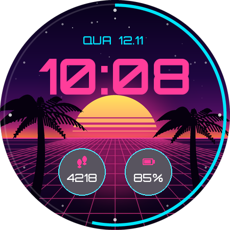

# Neon Beach — mostrador para Galaxy Watch (Wear OS)

Mostrador digital retrô neon (pôr do sol, palmeiras, grade em perspectiva) feito em
**Watch Face Format v1**, o formato exigido pela Google Play para novos mostradores.
Funciona em Wear OS 4+ (Galaxy Watch4 e mais novos).



## O que tem

- Hora digital (12/24h conforme o relógio), dia da semana em português e data
- Anel de segundos (pode desligar)
- 2 complicações editáveis (padrão: passos e bateria)
- Cenários **Pôr do sol** e **Noite**, 5 cores
- Modo sempre ativo (AOD) em fundo preto

## Estrutura

```
watchface/
  app/src/main/AndroidManifest.xml      app sem código (hasCode=false)
  app/src/main/res/raw/watchface.xml    o mostrador (WFF)
  app/src/main/res/xml/watch_face_info.xml
  app/src/main/res/drawable-nodpi/      fundos, ícones das opções, preview
  app/src/main/res/font/                Orbitron (licença OFL, ver FONT_LICENSE_Orbitron_OFL.txt)
  tools/generate_assets.py              gera toda a arte (original, procedural)
  store-listing/                        ficha da Play Store, ícone, banner e capturas
```

Para refazer as imagens: `python3 tools/generate_assets.py` (precisa de Pillow).

## Gerar o bundle (.aab) para a Play Store

**Pelo GitHub (recomendado):** o workflow `.github/workflows/watchface.yml` compila a cada push.
Cadastre estes segredos em *Settings → Secrets and variables → Actions* para o `.aab` sair assinado
com a chave de upload:

| Segredo | Valor |
|---|---|
| `WATCHFACE_KEYSTORE_BASE64` | keystore em base64 |
| `WATCHFACE_KEYSTORE_PASSWORD` | senha do keystore |
| `WATCHFACE_KEY_ALIAS` | alias da chave |
| `WATCHFACE_KEY_PASSWORD` | senha da chave |

O arquivo fica em *Actions → execução → Artifacts → neon-beach-watchface*.

**No computador (Android Studio / SDK instalado):** crie `watchface/keystore.properties`
(já está no `.gitignore`):

```
storeFile=/caminho/neonbeach-upload.jks
storePassword=...
keyAlias=neonbeach-upload
keyPassword=...
```

e rode `./gradlew bundleRelease` dentro de `watchface/`.
Saída: `app/build/outputs/bundle/release/app-release.aab`.

## Testar no relógio antes de enviar

1. No relógio: Configurações → Sobre o relógio → Software → toque 7× em "Versão do software";
   depois Opções do desenvolvedor → Depuração ADB e Depurar por Wi-Fi.
2. `adb connect IP_DO_RELOGIO:PORTA` e `adb install app-debug.apk` (vem junto no artifact do CI).
3. Toque e segure o mostrador atual, deslize até o fim e escolha **Neon Beach**.

## Enviar para a Play Store

1. Play Console → **Criar app** → nome `Neon Beach: Mostrador Retrô`, idioma pt-BR, App, Gratuito.
2. **Configuração → Recursos avançados → Formatos**: adicione **Wear OS**.
3. Preencha a ficha com os textos de [`store-listing/ficha-play-store.md`](store-listing/ficha-play-store.md)
   e envie as imagens da mesma pasta (na aba Wear OS use as capturas de `store-listing/screenshots/`).
4. Conteúdo do app: política de privacidade, segurança dos dados ("não coleta"), classificação, público-alvo
   (13+ ou todos), sem anúncios.
5. **Testes → Teste interno** (ou Produção) → *Criar versão* → envie o `app-release.aab` →
   aceite o **Play App Signing** → revisar e lançar.

> Contas pessoais criadas depois de nov/2023 precisam de **teste fechado com 12 testadores por 14 dias**
> antes de liberar a produção. Comece esse teste o quanto antes.
